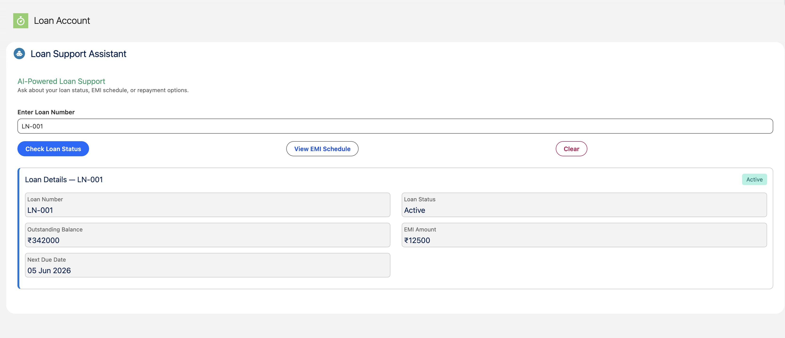
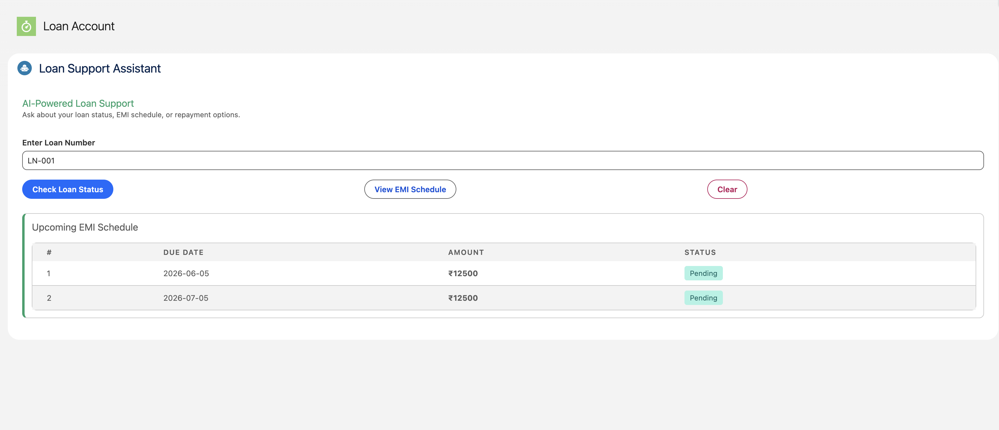

# AI-Powered Loan Support Agent — Salesforce Agentforce + LWC

An end-to-end loan servicing solution built on Salesforce. An Agentforce Service Agent answers customers' loan questions through Apex actions, and a Lightning Web Component serves the same data to the Lightning UI from the same Apex classes.

All data in this repository is synthetic.

## Screenshots

### Loan Status View



### EMI Schedule View



## Architecture

```
Customer Query
      ↓
Agentforce Service Agent (Loan_Support_Agent)
      ↓
Topics: Loan Status Inquiry / EMI Schedule Inquiry / General loan questions
      ↓
Agent Actions (GenAiFunction) → Apex Invocable Methods
      ↓
Custom Objects (Loan_Account__c / EMI_Schedule__c)

Lightning UI → loanSupportChat (LWC) → same Apex classes via @AuraEnabled
```

## Key Design Decision — Dual Apex Architecture

Each Apex action class serves two consumers:

- **`@InvocableMethod`** — called by the Agentforce agent actions
- **`@AuraEnabled`** — called directly by the `loanSupportChat` LWC

One business-logic layer serves both the AI and the UI, so there is no duplicated query or formatting code.

## What's in the Repository

| Area | Contents |
| --- | --- |
| Apex | `LoanStatusAction`, `EMIScheduleAction` and their test classes |
| LWC | `loanSupportChat` |
| Objects | `Loan_Account__c`, `EMI_Schedule__c` (master-detail to Loan Account) |
| Security | `Loan_Agent_Access` permission set (object, field and class access) |
| Agent metadata | `Bot`, `GenAiPlannerBundle` and two `GenAiFunction` actions |
| Sample data | `data/` (6 loans and 20 EMI records, as a Salesforce CLI data plan) |
| Dev tooling | ESLint, Prettier, Jest and Husky configuration |

## Agent Actions

| Action | Apex class | Returns |
| --- | --- | --- |
| Get Loan Status | `LoanStatusAction` | Loan status, outstanding balance, next EMI due date and EMI amount for a loan number |
| Get EMI Schedules | `EMIScheduleAction` | The next 3 upcoming pending EMI payments for a loan number |

Topic and instruction details: see [docs/agent-config.md](docs/agent-config.md).

## Custom Objects

**Loan_Account__c**

- Loan Number, Customer Name, Principal Amount
- Outstanding Balance, EMI Amount, Status, Next Due Date

**EMI_Schedule__c**

- Master-Detail to Loan Account
- Due Date, Amount, Status (Pending / Paid / Overdue)

## How to Deploy (Scratch Org)

Prerequisites: Salesforce CLI (`sf`) and a Dev Hub org that can create scratch orgs with Agentforce.

1. Clone this repository and authorise your Dev Hub:

```
sf org login web --alias my-devhub --set-default-dev-hub
```

2. Create a scratch org. `config/project-scratch-def.json` enables Agentforce (`Einstein1AIPlatform` and the `einsteinGptSettings` setting):

```
sf org create scratch --target-dev-hub my-devhub --alias loan-scratch --duration-days 7 --definition-file config/project-scratch-def.json
```

3. Deploy everything (Apex, objects, LWC, permission set, agent metadata):

```
sf project deploy start --source-dir force-app --target-org loan-scratch
```

4. Assign access to your user:

```
sf org assign permset --name Loan_Agent_Access --target-org loan-scratch
```

5. Load the synthetic sample data:

```
sf data import tree --plan data/Loan_Account__c-EMI_Schedule__c-plan.json --target-org loan-scratch
```

6. Run the tests:

```
sf apex run test --code-coverage --result-format human --wait 10 --target-org loan-scratch
```

7. In the org, open Setup → Agentforce Agents, activate **Loan Support Agent**, and try it in Preview with a loan number from the sample data.

8. Add the `loanSupportChat` LWC to a Loan Account record page through App Builder.

### Notes

- The agent is chat-only. The voice-channel context variable (`VoiceCallId`) was removed from the bot metadata so the agent deploys to an org without Service Cloud Voice.
- If the bot deploy complains about the agent user in your org, update the `botUser` value in `bots/Loan_Support_Agent/Loan_Support_Agent.bot-meta.xml`.

## Test Results

Clean scratch org run: 4 tests pass.

- `LoanStatusActionTest` — loan found, loan not found
- `EMIScheduleActionTest` — pending EMIs returned, no pending EMIs

| Class | Coverage |
| --- | --- |
| `LoanStatusAction` | 96% |
| `EMIScheduleAction` | 100% |

## What I Would Add in Production

- Einstein Sentiment Analysis on customer queries
- Escalation flow to a human agent for defaulted loans
- Platform Event logging of every agent interaction to a support query log object
- Named Credential authentication for external loan bureau APIs
- A Data 360 retriever to ground answers to general loan questions in policy documents
- Experience Cloud deployment for a customer-facing portal

## Author

**Nishika Jain** — Salesforce Developer | Agentforce Specialist

[LinkedIn](https://www.linkedin.com/in/nishikajain09) · [GitHub](https://github.com/nishika2712)